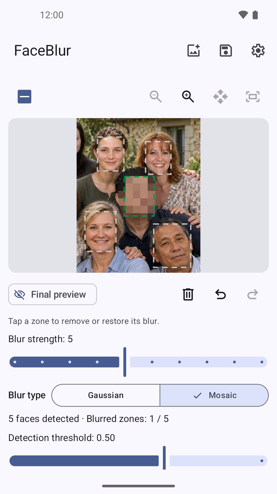
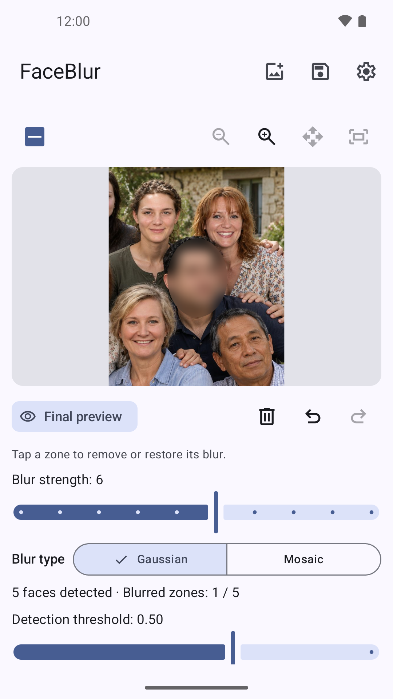
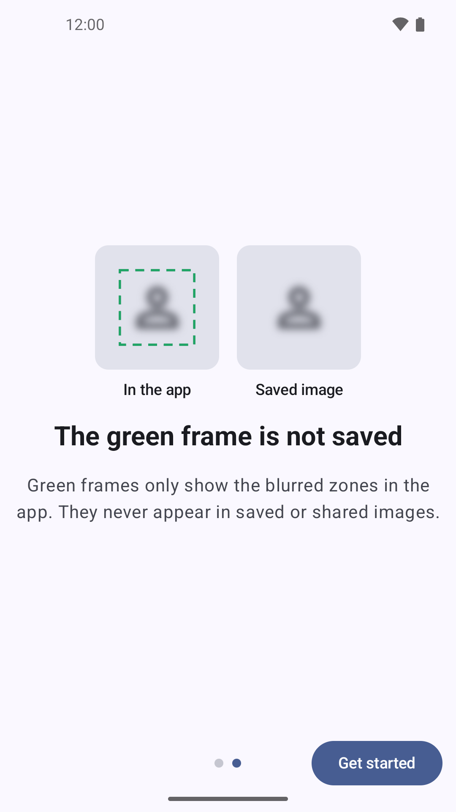
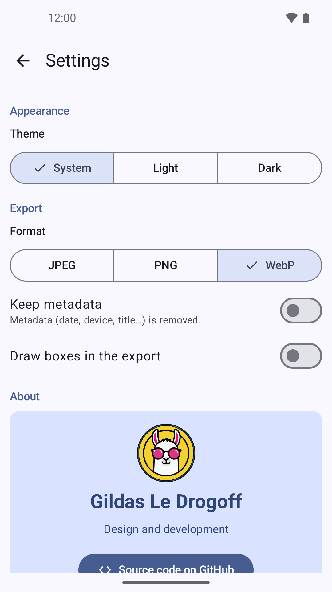
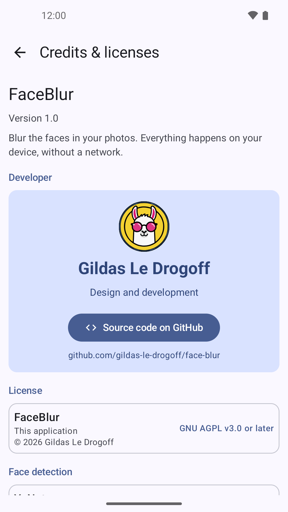

# FaceBlur

**Blur faces in your photos before sharing them. Everything happens on your device: no network access, no tracking, no photo ever leaves your phone.**

[](https://github.com/gildas-le-drogoff/face-blur/actions/workflows/ci.yml)
[](https://github.com/gildas-le-drogoff/face-blur/actions/workflows/reproducible.yml)
[](https://github.com/gildas-le-drogoff/face-blur/actions/workflows/reuse.yml)
[](LICENSE)

Website: <https://gildas-le-drogoff.github.io/face-blur/>
([French version](https://gildas-le-drogoff.github.io/face-blur/fr/))

## Screenshots

| Editor (mosaic) | Editor (Gaussian blur) | Onboarding | Settings | Credits |
| :---: | :---: | :---: | :---: | :---: |
|  |  |  |  |  |

French screenshots are in
[`fastlane/metadata/android/fr-FR`](fastlane/metadata/android/fr-FR/images/phoneScreenshots).
They are regenerated from a running emulator with `./generate-screenshots.sh`.

## Features

- Automatic face detection (YuNet model), executed entirely on device
- Gaussian blur or mosaic, with adjustable strength and tile size
- Tap a face to exclude or restore it; draw extra blur zones manually
- Zoom and pan to check every detail
- Export as JPEG, PNG or WebP
- Metadata (date, device, title…) removed by default, optionally kept
- Offline, translated in English, French, German, Italian and Spanish

## Install

Prebuilt APKs are published on the
[releases page](https://github.com/gildas-le-drogoff/face-blur/releases).
The app should also be available on F-Droid once its inclusion request is
accepted.

## Face detection model

FaceBlur embeds the
[YuNet](https://github.com/opencv/opencv_zoo/tree/main/models/face_detection_yunet)
model from the [OpenCV Zoo](https://github.com/opencv/opencv_zoo)
(`face_detection_yunet_2026may.onnx`, MIT licence, © 2020 Shiqi Yu). The
model is data, not executable code: it is run by a pure-Kotlin ONNX engine
(`app/src/main/java/fr/gildasledrogoff/faceblur/data/onnx`), with no native
inference library.

- Provenance, pinned upstream URL, licence and SHA-256 are documented next to
  the model in
  [`face_detection_yunet_2026may.SOURCE.md`](app/src/main/assets/face_detection_yunet_2026may.SOURCE.md);
- The checksum is verified by CI, and can be checked locally:

```sh
cd app/src/main/assets && sha256sum -c face_detection_yunet_2026may.onnx.sha256
```

## Build

Requirements: JDK 21 and the Android SDK (compileSdk 37).

```sh
./gradlew assembleRelease
```

The release APK is **unsigned** unless a `keystore.properties` file exists at
the root of the repository (see `generate-keystore-and-build.sh` for the local
signing setup; the CI release signs via repository secrets). F-Droid builds the
unsigned APK from source and signs it with its own key, which is why no debug
signing fallback exists.

## Contribution

Whether you have ideas, translations, design changes, code cleaning, or even
major code changes, help is always welcome. The app gets better and better with
each contribution, no matter how big or small! If you'd like to get involved,
check our [contribution notes](.github/CONTRIBUTING.md).


## Privacy

The FaceBlur project aims to provide a private, anonymous experience. The app
does not collect any data and performs no network access
to process your photos.

## Licence

Copyright © 2026 Gildas Le Drogoff

FaceBlur is free software: you can redistribute it and/or modify it under the
terms of the GNU Affero General Public License as published by the Free
Software Foundation, either version 3 of the License, or (at your option) any
later version. See [LICENSE](LICENSE).

The repository follows the [REUSE](https://reuse.software) specification:
licence texts are in [`LICENSES/`](LICENSES) and per-file attributions in
[`REUSE.toml`](REUSE.toml).

Bundled components:

- YuNet face detection model — MIT, © 2020 Shiqi Yu
- Kotlin, AndroidX / Jetpack Compose — Apache License 2.0
- Material Symbols icons — Apache License 2.0, © Google

The full licence texts are also shown in the app, in the "Credits & licenses" screen.
